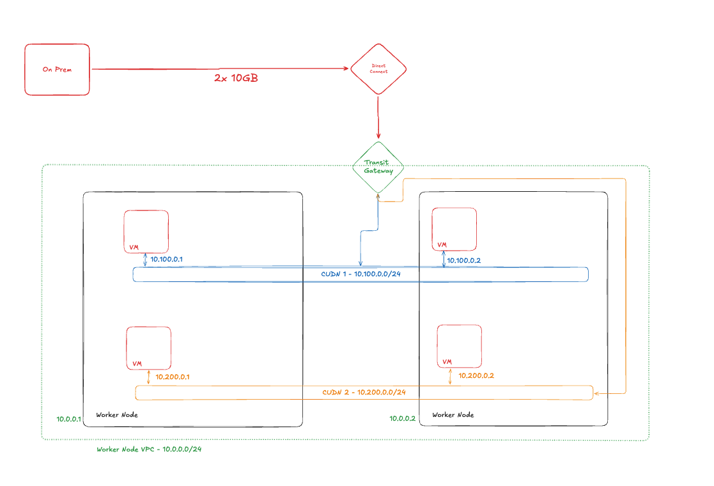

# BGP Direct Routing on ROSA HCP

Demonstrates Layer 3 direct (non-NAT) routing for pod networks on ROSA HCP using the [bgp-cloud-connector](https://github.com/openshift/bgp-cloud-connector) operator and AWS VPC Route Server.

Pods and VMs on a Cluster User-Defined Network (CUDN) get IPs that are directly routable from within the VPC: no NodePort, no LoadBalancer, no NAT. This is particularly useful for OpenShift Virtualization VMs that need to be addressed as native hosts on the network.

The demo deploys **two** networks, `red` and `blue`, to show the second property that comes with them: they are both reachable from the VPC, and they cannot reach each other.

## Architecture

```
┌─────────────────────────────────────────────────────────────┐
│                        AWS VPC (10.0.0.0/16)                │
│                                                             │
│  ┌─────────────────┐       BGP (TCP 179)       ┌────────┐  │
│  │ m5.metal worker  │◄────────────────────────►│  VPC   │  │
│  │ (bgp_router=true)│  AS 65001 ◄──► AS 65000  │ Route  │  │
│  │                  │                           │ Server │  │
│  │  ┌────────────┐  │                           └───┬────┘  │
│  │  │ FRR-K8S    │  │                               │       │
│  │  │ (frr pod)  │  │                     propagates routes  │
│  │  └────────────┘  │                               │       │
│  │                  │                           ┌───▼────┐  │
│  │  ┌────────────┐  │                           │ Subnet │  │
│  │  │ vm-red      │  │ ◄── directly routable    │ Route  │  │
│  │  │ 10.100.x.x │  │      from any subnet      │ Tables │  │
│  │  └────────────┘  │                           └────────┘  │
│  │  ┌────────────┐  │                                        │
│  │  │ vm-blue     │  │ ◄── also directly routable            │
│  │  │ 10.101.x.x │  │     …but red ⇄ blue is dropped         │
│  │  └────────────┘  │                                        │
│  └─────────────────┘                                        │
└─────────────────────────────────────────────────────────────┘
```

Both networks share one `BGPCloudConfiguration`, one Route Server, one set of
router nodes and one `RouteAdvertisements`. Only the `BGPRouting` CRs differ.

## Reference architecture

Where this leads: two isolated CUDNs carrying VMs, reachable from an
on-premises site over Direct Connect.



**This demo builds the in-VPC portion only.** BGP gets both CUDN prefixes into
the VPC route tables, and that is where `rosa/bgp.tf` stops. Extending to
on-premises is additional work this repo does not do, because none of it
follows automatically from the BGP session:

| Hop | Automatic? |
|:---|:---|
| Cluster → VPC subnet route tables | Yes (BGP and route server propagation) |
| VPC → Transit Gateway route table | **No**: a static route per CUDN prefix |
| Transit Gateway → on-premises | **No**: Direct Connect gateway allowed prefixes |
| On-premises → Transit Gateway | Yes (propagated from the Direct Connect attachment) |
| Node → on-premises (return path) | **No**: a route in the VPC subnet route tables |

A Transit Gateway VPC attachment propagates only the *VPC's own CIDR blocks*
into the TGW route table; it never reads your subnet route tables. The CUDN
prefixes live only in the subnet route tables, so the TGW cannot learn them and
needs static routes pointing at the VPC attachment.

Direct Connect must use a **Transit Gateway** association, not a virtual
private gateway. On a TGW association the allowed-prefix list is *originated*
by the Direct Connect gateway, so it can advertise prefixes outside the VPC
CIDR. On a VGW association it only *filters* the VPC CIDR, and a CUDN prefix
could never be advertised at all.

One caveat on those static routes: they do not track BGP. If the cluster
withdraws a prefix, the VPC route tables update but the TGW static route still
points at the VPC attachment, so traffic blackholes inside the VPC rather than
failing over.

## Prerequisites

- OpenShift 4.21+ (for CUDN and RouteAdvertisements APIs)
- AWS region with VPC Route Server support (eu-west-2, us-east-1, us-east-2, etc.)
- `oc` CLI logged into the cluster

## Step 1: Deploy Infrastructure

From `andys-demo-cluster-tf/`:

```bash
# Export your AWS and Red Hat credentials first.
export RHCS_TOKEN=$(ocm token)
terraform apply -var-file=bgp_rosa.tfvars
```

This creates:
- ROSA HCP cluster with an m5.metal worker node (labeled `bgp_router=true`)
- AWS VPC Route Server with endpoints in each private subnet
- Route propagation to all subnet route tables
- RFC1918 security group on the metal node
- IRSA role for the bgp-cloud-connector operator

Note the outputs:
```bash
terraform output bgp_iam_role_arn
terraform output bgp_route_server_id
terraform output bgp_endpoint_ips
```

## Step 2: Build and Deploy the Operator

The operator is built in-cluster using OpenShift Builds (local builds won't work on ARM Macs).

```bash
# Create namespace and build resources
oc create namespace openshift-bgp-cloud-connector --dry-run=client -o yaml | oc apply -f -
oc create imagestream bgp-cloud-connector -n openshift-bgp-cloud-connector

# Create BuildConfig
cat <<'EOF' | oc apply -f -
apiVersion: build.openshift.io/v1
kind: BuildConfig
metadata:
  name: bgp-cloud-connector
  namespace: openshift-bgp-cloud-connector
spec:
  output:
    to:
      kind: ImageStreamTag
      name: bgp-cloud-connector:latest
  source:
    type: Git
    git:
      uri: https://github.com/openshift/bgp-cloud-connector.git
      ref: main
  strategy:
    type: Docker
    dockerStrategy:
      dockerfilePath: Dockerfile
  triggers: []
EOF

# Build the image
oc start-build bgp-cloud-connector -n openshift-bgp-cloud-connector --follow
```

Deploy using the operator's kustomize config:
```bash
git clone https://github.com/openshift/bgp-cloud-connector.git /tmp/bgp-cloud-connector

# Point the kustomize image to the in-cluster build
sed -i '' 's|newName: controller|newName: image-registry.openshift-image-registry.svc:5000/openshift-bgp-cloud-connector/bgp-cloud-connector|' \
  /tmp/bgp-cloud-connector/config/manager/kustomization.yaml

oc kustomize /tmp/bgp-cloud-connector/config/default | oc apply -f -
```

## Step 3: Configure AWS Credentials (IRSA)

Annotate the operator's ServiceAccount with the IAM role from Terraform:

```bash
ROLE_ARN=$(cd andys-demo-cluster-tf && terraform output -raw bgp_iam_role_arn)

oc annotate serviceaccount openshift-bgp-cloud-connector-controller-manager \
  -n openshift-bgp-cloud-connector \
  eks.amazonaws.com/role-arn=$ROLE_ARN

oc rollout restart deployment/openshift-bgp-cloud-connector-controller-manager \
  -n openshift-bgp-cloud-connector
```

The operator picks its credential path at runtime: if the pod already has usable
AWS credentials it uses them, otherwise it creates a `CredentialsRequest` and
waits for the Cloud Credential Operator. Annotating the ServiceAccount puts it
on the first path. The operator's own docs now call CCO (`ROLEARN` on the
Subscription) the recommended path and IRSA the alternative for dev/test. IRSA
is kept here because this demo deploys from a kustomize build rather than a
Subscription. The Terraform IAM role trusts both the `openshift` and
`sts.amazonaws.com` audiences, so it serves either path unchanged.

## Step 4: Apply BGP Configuration

Update `bgp-cloud-configuration.yaml` with your Route Server ID:

```bash
RS_ID=$(cd andys-demo-cluster-tf && terraform output -raw bgp_route_server_id)
sed "s/REPLACE_ME/$RS_ID/" bgp-cloud-configuration.yaml | oc apply -f -
```

Wait for it to go `Ready`. The `BGPRouting` CRs sit in `Pending` until it does:

```bash
oc wait bgpcloudconfiguration cluster --for=jsonpath='{.status.phase}'=Ready --timeout=300s
```

Then create the namespaces and the two networks:

```bash
oc apply -f namespace.yaml
oc apply -f bgp-routing.yaml
oc apply -f test-pod.yaml
```

Order matters: the namespaces must exist and be labelled **before** the
`BGPRouting` CRs, or they go `Degraded` with `NamespaceNotReady`. The
`k8s.ovn.org/primary-user-defined-network` label has to be set at namespace
creation: admission refuses to add it to a namespace that already exists.

Do **not** hand-write a `ClusterUserDefinedNetwork`. The operator creates one
per `BGPRouting`, named `cluster-udn-<name>`, and labels it `advertise: "true"`
so the shared `RouteAdvertisements` picks it up.

## Step 5: Install OpenShift Virtualization (optional)

To test BGP routing with VMs:

```bash
oc apply -f ../openshift-virt/namespace.yaml -f ../openshift-virt/operator-group.yaml
oc apply -f ../openshift-virt/subscription.yaml
# Wait for CSV to succeed
oc get csv -n openshift-cnv -w
oc apply -f ../openshift-virt/hyperconverged.yaml
# Wait for Available=True
oc get hyperconverged kubevirt-hyperconverged -n openshift-cnv -w
```

If the subscription stays in `UpgradePending` and no CSV ever appears, check
whether it sets a `startingCSV` your cluster's catalog no longer carries.
Remove the line and let the `stable` channel resolve to the build matching
your cluster:

```bash
oc get packagemanifest kubevirt-hyperconverged -n openshift-marketplace \
  -o jsonpath='{range .status.channels[*]}{.name}{" -> "}{.currentCSV}{"\n"}{end}'
```

Then create the two test VMs:
```bash
oc apply -f test-vm.yaml
```

The VMs use the `l2bridge` interface binding, which is required in a
primary-UDN namespace and is the default there. The `masquerade` binding
installs nftables rules in the virt-launcher pod that drop inbound traffic on
the UDN interface, so the VM is unreachable from outside even when BGP is
advertising its subnet correctly. `l2bridge` needs no `HyperConverged`
configuration.

## Step 6: Validate

Check operator status (all conditions should be True):
```bash
oc get bgpcloudconfiguration cluster -o jsonpath='{.status.conditions}' | python3 -m json.tool
oc get bgprouting
```

Both networks should report `Ready`, with one CUDN each and one shared
RouteAdvertisements between them:

```bash
oc get clusteruserdefinednetwork
oc get routeadvertisements
```

Check BGP peering. Both prefixes should be in the table:
```bash
FRR_POD=$(oc get pods -n openshift-frr-k8s -l app=frr-k8s -o name | head -1)
oc exec -n openshift-frr-k8s $FRR_POD -c frr -- vtysh -c "show bgp summary"
oc exec -n openshift-frr-k8s $FRR_POD -c frr -- vtysh -c "show ip bgp"
```

Verify routes in VPC route tables:
```bash
VPC_ID=$(aws ec2 describe-vpcs --region eu-west-2 --filters "Name=tag:Name,Values=poc-andyr-vpc" \
  --query 'Vpcs[0].VpcId' --output text)
aws ec2 describe-route-tables --region eu-west-2 --filters "Name=vpc-id,Values=$VPC_ID" \
  --query 'RouteTables[*].Routes[?DestinationCidrBlock==`10.100.0.0/16` || DestinationCidrBlock==`10.101.0.0/16`]'
```

Pods and VMs on a CUDN get two IPs:
- **CUDN (primary)**: 10.100.x.x / 10.101.x.x on `ovn-udn1`, directly routable from the VPC
- **Cluster (infrastructure)**: 10.131.x.x on `eth0`, marked `infrastructure-locked`, carries kubelet probe traffic only

```bash
oc get pod -n vms-red client-red -o jsonpath='{.metadata.annotations.k8s\.ovn\.org/pod-networks}' | python3 -m json.tool
oc get vmi -n vms-red vm-red -o jsonpath='{.status.interfaces}' | python3 -m json.tool
```

### Reachability

From an EC2 instance in the same VPC (not from cluster nodes, which route
through OVN), both VMs answer directly:

```bash
RED=$(oc get vmi -n vms-red vm-red -o jsonpath='{.status.interfaces[0].ipAddress}')
BLUE=$(oc get vmi -n vms-blue vm-blue -o jsonpath='{.status.interfaces[0].ipAddress}')

curl http://$RED      # red network  - CUDN cluster-udn-red  - 10.100.0.0/16
curl http://$BLUE     # blue network - CUDN cluster-udn-blue - 10.101.0.0/16
```

### Isolation

From inside the cluster, red cannot reach blue even though both subnets are in
the same VRF and both are learned back from the Route Server:

```bash
oc exec -n vms-red client-red -- curl -s --max-time 5 http://$RED    # succeeds
oc exec -n vms-red client-red -- curl -s --max-time 5 http://$BLUE   # times out
```

The packet egresses the cluster toward the provider network, and OVN drops it
on the way back in. This is the default (`strict`) advertised-UDN isolation
behaviour. Nothing in this demo configures it.

## Cleanup

```bash
oc delete -f test-vm.yaml -f test-pod.yaml -f bgp-routing.yaml -f namespace.yaml
oc delete bgpcloudconfiguration cluster
oc kustomize /tmp/bgp-cloud-connector/config/default | oc delete -f -
cd andys-demo-cluster-tf && terraform destroy -var-file=bgp_rosa.tfvars
```

Delete the `BGPRouting` CRs before the `BGPCloudConfiguration`: its finalizer
blocks deletion while routing CRs exist (`RoutingCRsExist`). Let the
`BGPCloudConfiguration` finish deleting before running Terraform: its finalizer
removes the Route Server peers and reverts the Network operator patch, and
Terraform cannot delete a Route Server that still has peers.

On ROSA, the operator's ClusterRoleBindings survive `oc delete`. They are named
`openshift-bgp-cloud-connector-*`, and the managed-cluster admission webhook
refuses to delete ClusterRoleBindings in the `openshift-` namespace prefix:

```
admission webhook "clusterrolebindings-validation.managed.openshift.io" denied
the request: Deleting ClusterRoleBinding openshift-bgp-cloud-connector-manager-
rolebinding is not allowed
```

Three are left behind. They are harmless (they reference a ServiceAccount that
no longer exists, and a reinstall simply updates them), but they cannot be
removed by a cluster admin.

## Notes

### Adding another network

Three things, and nothing else changes:

1. A namespace labelled `k8s.ovn.org/primary-user-defined-network: ""` and `cluster-udn: <name>` at creation.
2. A `BGPRouting` with a unique `spec.network.name` and a non-overlapping subnet.
3. Nothing: the shared `RouteAdvertisements` picks it up from the `advertise: "true"` label the operator applies.

`spec.network.name` uniqueness is enforced (`DuplicateNetwork`); subnet overlap
is not, so check it yourself against the other networks and the VPC CIDR.

### Isolation has a hole: services

The isolation ACLs cover pod and cluster-IP addresses. If a workload is exposed
through a LoadBalancer, NodePort or ExternalIP service, the other network *can*
reach it by that path. Don't expose these networks that way if the isolation
matters. `advertised-udn-isolation-mode: loose` relaxes the isolation
deliberately. Leave it alone.

### Primary UDN limits what you can do to a VM

On a primary UDN you cannot use `virtctl ssh`, `oc port-forward` to the VM, or
headless services. All three use the same path: they reach the VM through the
virt-launcher pod's default-cluster-network address, and on a primary UDN that
interface is `infrastructure-locked`: OVN ACLs permit only kubelet probe
traffic on it, and host-side nftables rules (chain `udn-isolation`) stop
non-kubelet host processes using it too. The guest lives on `ovn-udn1`, which
those tools never dial.

For this demo it barely matters: the UDN address is routable from the VPC, so
`ssh fedora@$RED` from a VPC host works. `virtctl console` also works, since it
goes over the serial path rather than the guest network.

### ROSA/public-cloud constraints

- Connecting VMs directly to the underlay network is **not supported on public clouds**. A secondary localnet CUDN (the usual way to put a VM on an existing VLAN) is therefore not an option on ROSA. Layer 2 overlay CUDNs advertised over BGP, which is what this demo does, are the supported shape.
- Using EVPN with BGP to extend layer 2 connectivity for primary cluster-scoped UDNs is likewise not supported on public clouds.
- The operator patches `Network.operator.openshift.io/cluster` to enable the FRR provider and route advertisements. On ROSA that CR is Red Hat–managed territory; treat the whole demo as a PoC on a throwaway cluster, not something to run on a cluster you care about the support status of.

### Other notes

- **Single router node**: This demo uses 1 m5.metal node. VPC Route Server installs only one active route per prefix in the FIB (no ECMP), so a single router works for demo purposes. For production, use 3 across AZs for failover.
- **Scale ceiling**: 100 routes per route server FIB, 100 per route server peer, and 100 propagated routes per route table. The last two are not adjustable. Layer2 CUDNs advertise one prefix each, so the ceiling is roughly 100 networks.
- **VRF names**: a CUDN of 15 characters or fewer gets a VRF of the same name; longer ones get a VRF named from the network ID. `cluster-udn-red` is 15, `cluster-udn-blue` is 16, so `vtysh -c "show ip route vrf cluster-udn-red"` works but blue's VRF needs looking up. Keep `spec.network.name` to 3 characters if you want both predictable.
- **Source/Dest Check**: The operator automatically disables source/destination checks on the router node's ENIs via the IRSA role.
- **Security Groups**: The metal node needs RFC1918 and allow-all security groups attached (via `additional_security_group_ids` on the machine pool, requires RHCS module >= 1.7.5). Without these, return traffic from CUDN IPs is blocked by the default cluster SG.
- **Testing from cluster nodes**: Pings from other cluster nodes go through OVN (not the VPC route table), so they're not a valid test of BGP routing. Use an EC2 instance in the same VPC instead.
- **Replicas quirk**: The RHCS provider reports `replicas` as the total compute across all pools. If terraform plan shows a replicas mismatch, use `terraform apply -refresh-only` targeting the cluster resource.
- Based on the [rosa-bgp PoC](https://github.com/rh-mobb/rosa-bgp) and [bgp-cloud-connector operator](https://github.com/openshift/bgp-cloud-connector).
